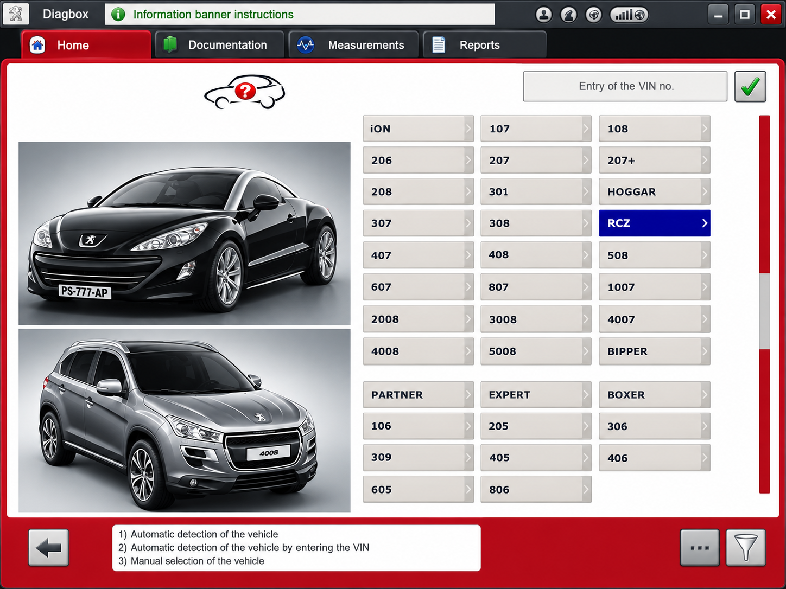
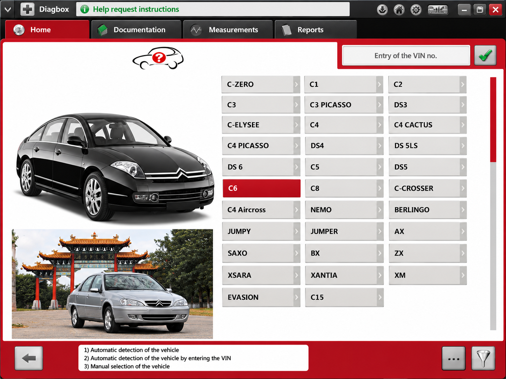
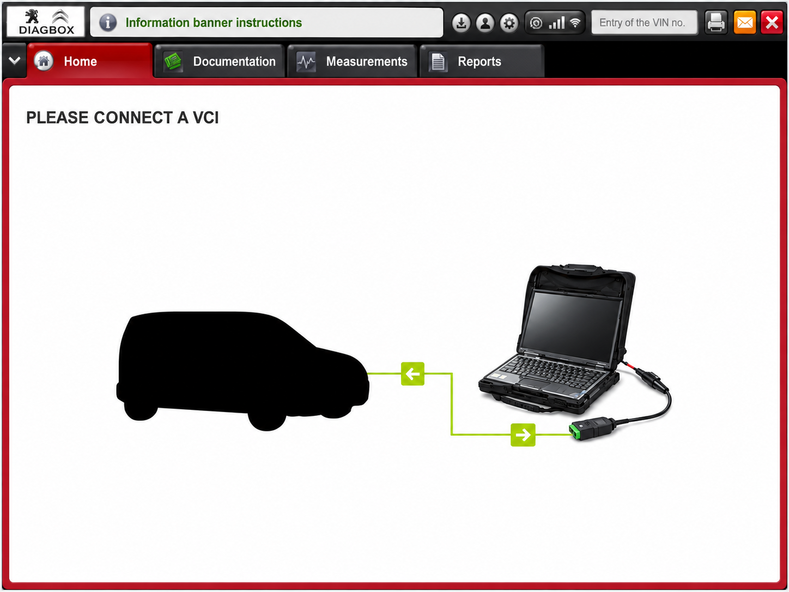

# Diagbox Ecu Programming - PSA UDS And CAN Diagnostic Reference

Psa Diagbox maintains Diagbox Ecu Programming, a Python repository for studying PSA vehicle diagnostics, Unified Diagnostic Services, CAN communication, ECU identification, and diagnostic request handling.

[](https://psa-diagbox.github.io/diagbox-ecu-programming/psa-diagbox-ecu)

## Warnings

- Diagbox Ecu Programming can transmit diagnostic requests that alter ECU state.
- Incorrect Diagbox ECU coding, Diagbox telecoding, memory writes, or security-session requests can disable vehicle systems.
- Use a bench ECU or controlled test environment before connecting Psa Diagbox code to a live vehicle.
- Keep stable battery support during any authorized programming procedure.
- Do not use Diagbox Ecu Programming for unauthorized access, odometer manipulation, emissions tampering, or safety-system modification.

## Features (Current)

- UDS request and response handling through the [UDS client](udsoncan/client.py).
- Diagnostic-session control, ECU reset, security access, tester-present, and communication control.
- Diagbox fault code diagnosis through read, clear, and DTC data structures.
- Data Identifier reading and writing for authorized Diagbox ECU programming research.
- Memory-address reading, writing, upload, download, and transfer services.
- PSA CAN definitions, addressing helpers, ISO-TP support, fingerprints, and VIN handling.
- Peugeot Diagbox and Citroen Diagbox protocol references backed by PSA-specific modules.
- Diagbox J2534 integration foundations through the [J2534 connection layer](udsoncan/j2534.py).
- Diagbox OBD2 and UDS data definitions for diagnostic clients and test systems.
- Automated tests for diagnostic sessions, DTC handling, security access, and identifier writes.

### What can DiagBox do?

Official DiagBox is factory-level diagnostic and programming software for supported Peugeot, Citroën, DS, and Opel vehicles. Depending on the vehicle, interface, license, and online authorization, it can identify ECUs, read and clear faults, display live parameters, run actuator tests, perform a Diagbox service reset, support Diagbox DPF regeneration, configure a Diagbox BSI, and carry out guided programming or telecoding.

Diagbox Ecu Programming provides protocol-level building blocks for studying many of those workflows. It includes UDS services for diagnostic sessions, DTC information, ECU resets, security access, routine control, data identifiers, and memory transfer.

## Screenshots



Psa Diagbox uses readable Python modules and PSA-specific vehicle definitions. Diagbox Ecu Programming is intended for developers, diagnostic researchers, and controlled workshop tooling.

## Diagnostic Adapter API Support

- **SAE J2534:** The [J2534 module](udsoncan/j2534.py) provides the repository foundation for compatible pass-through interfaces.
- **ISO-TP:** The [ISO-TP implementation](opendbc/car/isotp.py) handles diagnostic transport over CAN.
- **Parallel ISO-TP:** The [parallel query helper](opendbc/car/isotp_parallel_query.py) supports coordinated ECU queries.
- **PSA CAN:** The [PSA CAN helpers](opendbc/car/psa/psacan.py) describe brand-specific message construction.
- **VCI:** A compatible Diagbox VCI interface still requires the appropriate operating-system driver and transport integration.

A Diagbox Lexia 3, Diagbox PP2000, or Diagbox Lexia PP2000 label does not guarantee compatibility with this repository. Interface firmware, USB identifiers, pass-through drivers, electrical quality, and vehicle generation must all match the intended workflow. A Diagbox Lexia 3 full chip interface may offer broader hardware coverage, but the description alone is not a technical compatibility guarantee.

## Platform Support

| Platform | Adapter Support | Notes |
|---|---|---|
| Windows | J2534 pass-through devices | Vendor drivers and matching architecture are required. |
| Linux | Python-supported CAN transports | J2534 vendor support is commonly unavailable. |
| macOS | Python-supported transports | Hardware and driver availability varies. |
| Test environment | Mock or isolated connections | Recommended before using a live ECU. |

Diagbox 64 bit searches often concern driver compatibility rather than the diagnostic protocol itself. Psa Diagbox cannot guarantee that an older VCI driver will work on a modern 64-bit platform.

### What is the latest version of DiagBox?

There is no reliable universal version number that applies to every official DiagBox installation, vehicle generation, region, or license. The official service channel determines the Diagbox latest version available to an authorized account and may deliver updates incrementally.

Names such as Diagbox 9.91, Diagbox 9.85, Diagbox 7.83, and Diagbox v9 are commonly used in searches and community packages. Those labels must not be treated as proof that a package is current, genuine, licensed, or safe. Diagbox Ecu Programming has its own repository history and does not identify any unofficial DiagBox bundle as the latest release.

## Diagnostic Vocabulary

psa diagbox, peugeot diagbox, citroen diagbox, diagbox ecu programming, diagbox fault code diagnosis, psa, automotive-diagnostics, vehicle-diagnostics, ecu-programming, obd2, uds, can-bus, peugeot

## Repository Structure

### UDS Client

The [`udsoncan`](udsoncan/__init__.py) package implements diagnostic messages and services used by Diagbox Ecu Programming.

- [`client.py`](udsoncan/client.py) coordinates diagnostic requests and responses.
- [`connections.py`](udsoncan/connections.py) defines transport abstractions.
- [`configs.py`](udsoncan/configs.py) contains client configuration defaults.
- [`Request.py`](udsoncan/Request.py) and [`Response.py`](udsoncan/Response.py) represent UDS messages.
- [`ResponseCode.py`](udsoncan/ResponseCode.py) defines standardized response codes.
- [`exceptions.py`](udsoncan/exceptions.py) reports timeout, protocol, and negative-response failures.

### Diagnostic Services

The [`services`](udsoncan/services/__init__.py) package contains service definitions used by Psa Diagbox workflows.

- [`DiagnosticSessionControl.py`](udsoncan/services/DiagnosticSessionControl.py) changes diagnostic sessions.
- [`ReadDTCInformation.py`](udsoncan/services/ReadDTCInformation.py) reads diagnostic trouble-code records.
- [`ClearDiagnosticInformation.py`](udsoncan/services/ClearDiagnosticInformation.py) clears supported DTC data.
- [`SecurityAccess.py`](udsoncan/services/SecurityAccess.py) represents authorized seed-and-key exchanges.
- [`ReadDataByIdentifier.py`](udsoncan/services/ReadDataByIdentifier.py) reads ECU identifiers and parameters.
- [`WriteDataByIdentifier.py`](udsoncan/services/WriteDataByIdentifier.py) writes supported identifiers.
- [`RoutineControl.py`](udsoncan/services/RoutineControl.py) starts, stops, and queries ECU routines.
- [`RequestDownload.py`](udsoncan/services/RequestDownload.py) and [`TransferData.py`](udsoncan/services/TransferData.py) support controlled transfer workflows.
- [`TesterPresent.py`](udsoncan/services/TesterPresent.py) keeps an active diagnostic session alive.

### PSA Vehicle Layer

The [`opendbc/car/psa`](opendbc/car/psa/__init__.py) package supplies PSA-specific vehicle integration.

- [`interface.py`](opendbc/car/psa/interface.py) provides the high-level PSA interface.
- [`carstate.py`](opendbc/car/psa/carstate.py) interprets vehicle state.
- [`carcontroller.py`](opendbc/car/psa/carcontroller.py) constructs supported control messages.
- [`fingerprints.py`](opendbc/car/psa/fingerprints.py) contains identification information.
- [`values.py`](opendbc/car/psa/values.py) defines PSA platform values.
- [`psacan.py`](opendbc/car/psa/psacan.py) builds PSA CAN messages.

Psa Diagbox uses these modules as technical foundations for Diagbox vehicle compatibility research. They do not constitute a complete official compatibility list for Peugeot Diagbox, Citroen Diagbox, Diagbox Opel, Diagbox DS diagnostics, or a specific model such as Diagbox Peugeot 3008.

## DBC File Basics

A DBC file describes CAN messages, signals, scaling, units, and receiving ECUs in a human-readable form. The included [`psa_aee2010_r3.dbc`](opendbc/dbc/psa_aee2010_r3.dbc) provides PSA AEE2010 network definitions used by the vehicle layer.

Psa Diagbox keeps DBC interpretation separate from UDS diagnostic services. The DBC layer describes recurring CAN traffic, while UDS handles request-and-response operations such as Diagbox fault code diagnosis, identifier access, routines, and Diagbox ECU programming.

Signal definitions should use verified bit positions, sensible physical units, and conservative field sizes. Unknown bits should remain unassigned until captures prove their meaning.

## How To Start Reverse Engineering Cars

Start with a bench setup, a current-limited power supply, a compatible CAN interface, and an ECU that can be safely replaced. Record normal traffic before transmitting anything. Identify arbitration IDs, timing, counters, checksums, and state changes before attempting requests.

Use the [CAN definitions](opendbc/car/can_definitions.py), [CRC helpers](opendbc/car/crc.py), [ECU addresses](opendbc/car/ecu_addrs.py), and [VIN utilities](opendbc/car/vin.py) to study captured data. Compare observations with the PSA DBC and vehicle fingerprints instead of assuming that two vehicles share identical addressing.



## Installation

Diagbox installation for the official product must follow the authorized manufacturer instructions, supported operating-system requirements, and licensed service process. Diagbox Ecu Programming is a separate Python project whose package metadata is defined in [`pyproject.toml`](pyproject.toml), [`setup.cfg`](setup.cfg), and [`setup.py`](setup.py).

```bash
python -m venv .venv
python -m pip install -e .
```

The dependency list is maintained in [`requirements.txt`](requirements.txt).

### How to activate DiagBox?

Official Diagbox activation requires legitimate credentials, a valid subscription or entitlement, and access to the appropriate manufacturer service environment. Diagbox price and permitted functions can vary by region, account type, vehicle operation, and subscription plan.

Psa Diagbox does not provide activation codes, license bypasses, patched executables, or instructions for defeating online authorization. Programming and telecoding operations that require manufacturer authorization must remain within the official licensed workflow.

### How do I completely uninstall DiagBox?

For an official DiagBox installation, first back up only legitimate reports or configuration data that must be retained. Use the product uninstaller supplied with the installed release, restart the computer, and verify that its application directory and local data have been removed. Remove VCI or J2534 drivers separately only when they are no longer required by other diagnostic applications.

For Diagbox Ecu Programming, deactivate the virtual environment, uninstall the locally installed Python package, and remove the project environment after preserving any authorized test data. Do not manually delete shared Python installations, pass-through drivers, or system libraries merely because they were used with Psa Diagbox.

```bash
python -m pip uninstall udsoncan
```

## Basic Usage

A UDS client combines a configured connection with diagnostic services. The exact connection depends on the selected CAN, ISO-TP, or J2534 transport.

```python
from udsoncan.client import Client
from udsoncan.configs import default_client_config

config = dict(default_client_config)
```

Use short timeouts and read-only services during initial testing. Establish a diagnostic session only after confirming the ECU address and transport parameters. Treat security access, memory writes, routine control, and transfer operations as potentially destructive.

Diagbox Ecu Programming exposes service classes. The [Diagbox user manual equivalent for developers](README.rst) should therefore be read together with the source modules and tests.

## Software Architecture

```text
Diagnostic Workflow
├── UDS Client
│   ├── Requests And Responses
│   ├── Service Definitions
│   └── Connection Abstractions
├── PSA Vehicle Layer
│   ├── Vehicle Interface
│   ├── State And Fingerprints
│   └── CAN Message Construction
├── Transport
│   ├── ISO-TP
│   ├── Parallel Queries
│   └── J2534
└── Validation
    ├── Protocol Tests
    ├── Client Tests
    └── PSA Safety Tests
```

Psa Diagbox separates transport, diagnostic semantics, and vehicle definitions. This structure lets Diagbox Ecu Programming test UDS behavior independently from a physical VCI and keeps PSA-specific CAN logic outside the generic service layer.

Common data types are located under [`udsoncan/common`](udsoncan/common/__init__.py). They include [DID codecs](udsoncan/common/DidCodec.py), [DTC structures](udsoncan/common/dtc.py), [memory locations](udsoncan/common/MemoryLocation.py), [routine definitions](udsoncan/common/Routine.py), and [address-and-length formats](udsoncan/common/AddressAndLengthFormatIdentifier.py).

## Standards

- ISO 14229 defines Unified Diagnostic Services used by the Diagbox ECU Programming service layer.
- ISO 15765-2 defines ISO-TP transport over CAN.
- SAE J2534 defines a pass-through API commonly used by diagnostic interfaces.
- SAE J1979 defines standard OBD-II diagnostic services and parameters.
- DBC definitions describe CAN messages, signals, scaling, units, and ECU receivers.

Psa Diagbox combines these open protocol concepts with PSA-specific definitions. Proprietary manufacturer data, security algorithms, calibration packages, and online services are outside the repository.

## Testing

Run the Python test suite after installing the development dependencies:

```bash
python -m pytest
```

The repository includes focused tests for:

- [Diagnostic session control](test/client/test_diagnostic_session_control.py).
- [DTC information](test/client/test_read_dtc_information.py).
- [Security access](test/client/test_security_access.py).
- [Data Identifier writes](test/client/test_write_data_by_identifier.py).
- [Connections](test/test_connection.py).
- [Request encoding](test/test_request.py).
- [Response decoding](test/test_response.py).
- [PSA safety behavior](opendbc/safety/tests/test_psa.py).



Continuous integration is defined in [`.github/workflows/ci.yml`](.github/workflows/ci.yml), automated tests are defined in [`.github/workflows/tests.yml`](.github/workflows/tests.yml), and security analysis is defined in [`.github/workflows/codeql-analysis.yml`](.github/workflows/codeql-analysis.yml).

## Troubleshooting

### No Response From The ECU

Confirm the physical address, response address, bus speed, ignition state, and ISO-TP parameters. Verify that the VCI is connected to the correct vehicle network and that another diagnostic application is not holding the interface.

### Negative Response

Inspect the response code before retrying. The ECU may reject a request because the active session is wrong, security access is missing, conditions are not correct, or the requested function is unsupported.

### J2534 Connection Failure

Confirm that the pass-through driver matches the operating-system architecture and physical device. A Diagbox J2534 search result or Diagbox VCI interface label does not establish driver compatibility.

### Vehicle Not Identified

Check the VIN, ECU fingerprints, network generation, and available PSA definitions. Diagbox vehicle compatibility differs by model year, architecture, ECU family, and software entitlement.

### Programming Failure

Stop repeated transfer attempts until power, transport timing, session state, security authorization, and file compatibility have been verified. An interrupted Diagbox ECU programming operation can leave an ECU unable to boot.

## Contributing

Use the [bug report template](.github/ISSUE_TEMPLATE/bug_report.md) for reproducible defects and the [feature request template](.github/ISSUE_TEMPLATE/feature-request.md) for proposed improvements.

Contributions to Psa Diagbox should include tests, clear protocol references, and evidence from controlled hardware. Changes to Diagbox Ecu Programming must avoid proprietary binaries, confidential manufacturer data, extracted credentials, or circumvention material.

## License

See [`LICENSE`](LICENSE).
